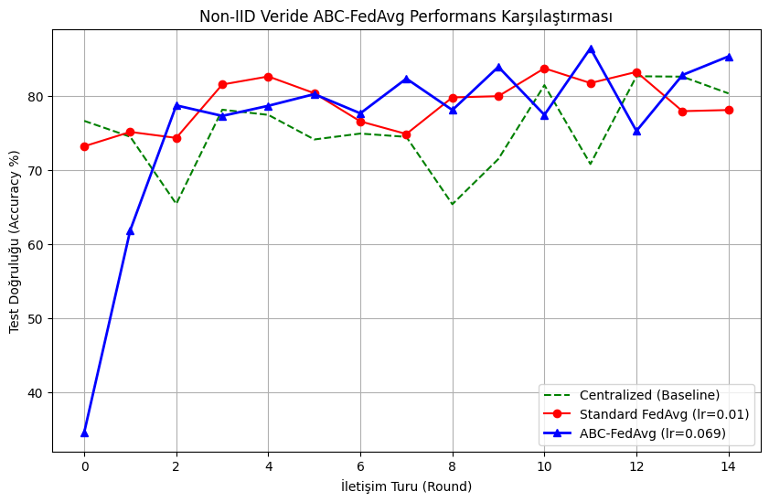

# 🐝 ABC Optimizer Lib

**Canonical Artificial Bee Colony (ABC) optimization in pure Python, with a scikit-learn compatible hyperparameter search.**


ABC Optimizer Lib is a faithful implementation of the **Artificial Bee Colony** algorithm proposed by **Derviş Karaboğa (2005)** at Erciyes University. It is useful for two things:

1. **Black-box optimization:** minimize any objective function within box constraints, with no gradients required.
2. **Hyperparameter tuning:** a drop-in alternative to `GridSearchCV` / `RandomizedSearchCV` for any scikit-learn compatible estimator (scikit-learn, LightGBM, XGBoost, …).

---

## ✨ Features

- **Canonical algorithm:** employed, onlooker (roulette-wheel selection) and scout bee phases, following the original paper; one dimension is perturbed per move.
- **scikit-learn API:** `ABCSearchCV` exposes `fit`, `predict`, `score`, `best_params_`, `best_score_` and `best_estimator_`.
- **Evaluation budget:** you set `max_evals`, so the run cost is predictable.
- **Convergence history:** every run returns its best-so-far curve for plotting and comparison.
- **Lightweight:** depends only on `numpy` and `scikit-learn`.
- **Mixed search spaces:** continuous (`float`) and integer (`int`) hyperparameters.

---

## 📦 Installation

```bash
pip install git+https://github.com/yusufkorkmazyigit/abc-optimizer-lib.git
```

For development:

```bash
git clone https://github.com/yusufkorkmazyigit/abc-optimizer-lib.git
cd abc-optimizer-lib
pip install -e .
```

---

## 🚀 Quick Start

### 1. Hyperparameter tuning with `ABCSearchCV`

```python
import lightgbm as lgb
from sklearn.datasets import load_breast_cancer
from abc_algorithm import ABCSearchCV

X, y = load_breast_cancer(return_X_y=True)

param_space = {
    "learning_rate": {"type": "float", "range": (0.01, 0.3)},
    "n_estimators":  {"type": "int",   "range": (50, 500)},
    "num_leaves":    {"type": "int",   "range": (20, 100)},
}

search = ABCSearchCV(
    estimator=lgb.LGBMClassifier(verbosity=-1),
    param_space=param_space,
    cv=3,
    scoring="accuracy",
    pop_size=20,     # number of food sources
    max_evals=100,   # total objective evaluations (each one = one CV run)
)
search.fit(X, y)

print("Best CV score:", search.best_score_)
print("Best params:  ", search.best_params_)
y_pred = search.predict(X)   # uses best_estimator_, refit on the full data
```

### 2. Function minimization with `CanonicalABCSolver`

```python
import numpy as np
from abc_algorithm import CanonicalABCSolver

def sphere(x):
    return np.sum(x ** 2)    # global minimum: 0 at x = 0

solver = CanonicalABCSolver(
    objective_func=sphere,
    n_params=3,
    lb=[-10, -10, -10],
    ub=[10, 10, 10],
    max_evals=500,
)
best_x, best_cost, history = solver.solve()
print(f"x* = {best_x}, f(x*) = {best_cost:.5f}")
```

### 3. Plotting convergence

```python
import matplotlib.pyplot as plt

evals, costs = zip(*history)          # or search.history_ after fit()
plt.plot(evals, costs)
plt.xlabel("Function evaluations")
plt.ylabel("Best cost")
plt.title("ABC convergence")
plt.show()
```

---

## 📖 API Reference

### `CanonicalABCSolver`

```python
CanonicalABCSolver(objective_func, n_params, lb, ub,
                   pop_size=20, max_evals=1000, limit=None)
```

| Parameter | Description |
|---|---|
| `objective_func` | Callable taking a 1-D `np.ndarray` and returning a scalar cost to **minimize** |
| `n_params` | Number of dimensions |
| `lb`, `ub` | Lower / upper bounds per dimension |
| `pop_size` | Number of food sources (SN) |
| `max_evals` | Total objective-function evaluation budget |
| `limit` | Trials without improvement before a source is abandoned (default: `pop_size × n_params`) |

`solve()` returns `(best_params, best_cost, history)`, where `history` is a list of `(eval_count, best_cost)` tuples.

### `ABCSearchCV`

```python
ABCSearchCV(estimator, param_space, cv=3, scoring="accuracy",
            pop_size=20, max_evals=200, limit=None, verbose=True)
```

- **`param_space`** maps each hyperparameter to `{"type": "float" | "int", "range": (low, high)}`.
- **`scoring`** accepts any scikit-learn scorer string. Scores are maximized; `neg_*` scorers (e.g. `neg_mean_squared_error`) are handled automatically.
- **After `fit`:** `best_params_`, `best_score_`, `best_estimator_` (refit on the full data), `history_`.

---

## 🧠 How ABC Works

ABC models the foraging behaviour of a honey bee colony. Each **food source** is a candidate solution, and its **nectar amount** is the solution's fitness.

| Phase | Role |
|---|---|
| **Employed bees** | Each one improves its own food source by perturbing one dimension towards or away from a random neighbour: `v_ij = x_ij + φ·(x_ij − x_kj)`, `φ ∈ [−1, 1]`. Greedy selection keeps the better solution. |
| **Onlooker bees** | Pick sources with probability proportional to fitness (roulette wheel), so promising regions are exploited more. |
| **Scout bees** | A source that has not improved for `limit` trials is abandoned and replaced by a random one, which keeps exploration alive. |

Fitness is derived from cost as `1 / (1 + f)` for `f ≥ 0` and `1 + |f|` otherwise.

---

## 🔬 Case Study: Federated Learning on MedMNIST

The library was used to tune a **federated learning** setup trained on **PathMNIST** (colon pathology images), with data split across **5 simulated hospitals** in a **non-IID** (imbalanced) way, a setting where standard **FedAvg** struggles.

`CanonicalABCSolver` optimized the clients' **learning rate** and **momentum**. Compared with default hyperparameters, the ABC-tuned model **converged faster and reached 7% higher accuracy**.



📓 [Full notebook and analysis](examples/Federated_Learning_MedMNIST_Optimization.ipynb) · Related repo: [fedLearningwithABC](https://github.com/yusufkorkmazyigit/fedLearningwithABC)

---

## 🗺️ Roadmap

- [ ] Categorical hyperparameters
- [ ] Parallel objective evaluations (`n_jobs`)
- [ ] Random seed parameter for reproducibility
- [ ] Benchmarks against `GridSearchCV`, `RandomizedSearchCV` and Optuna
- [ ] PyPI release

Contributions and issues are welcome.

---

## 📚 Reference

Karaboğa, D. (2005). *An Idea Based on Honey Bee Swarm for Numerical Optimization*. Technical Report TR06, Erciyes University, Engineering Faculty, Computer Engineering Department.

If you use this library in your research, please cite the original paper above and link to this repository.

## 📝 License

Released under the [MIT License](LICENSE).

---

<sub>Developed by [Yusuf Korkmazyiğit](https://github.com/yusufkorkmazyigit), Computer Engineering, Erciyes University.</sub>
